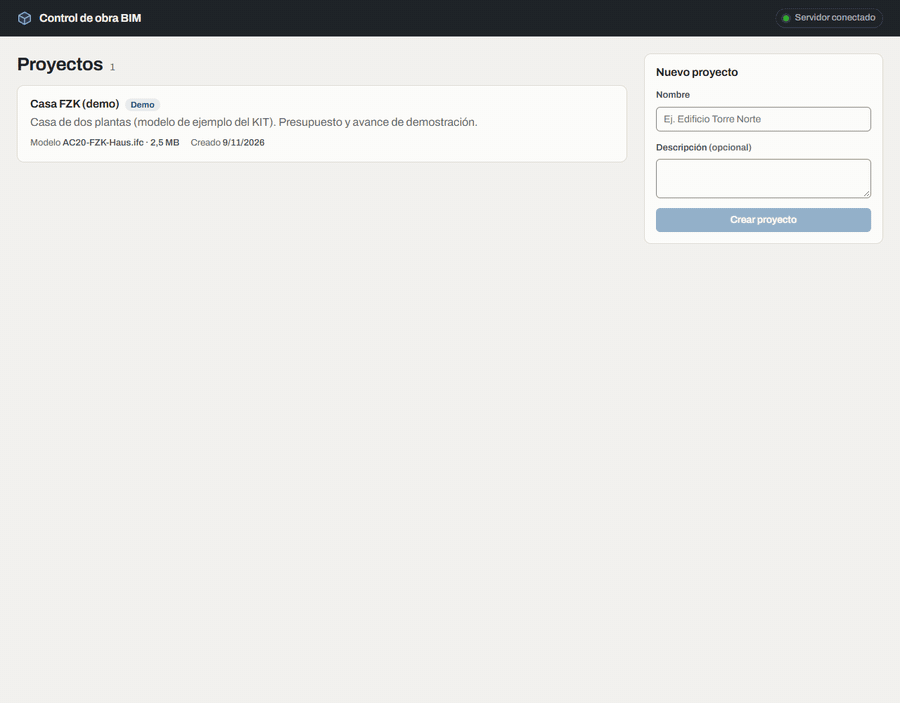
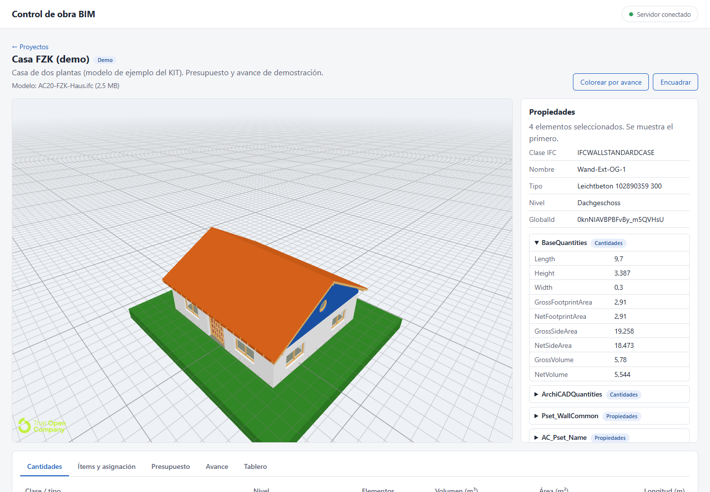
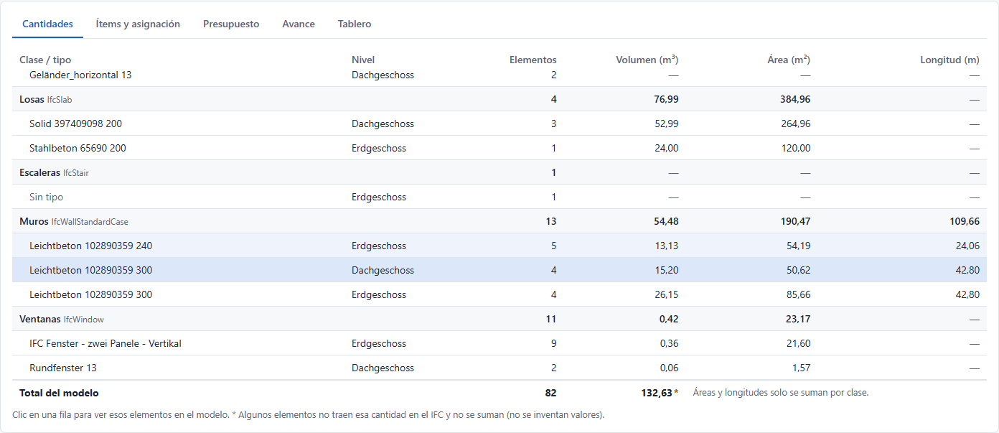
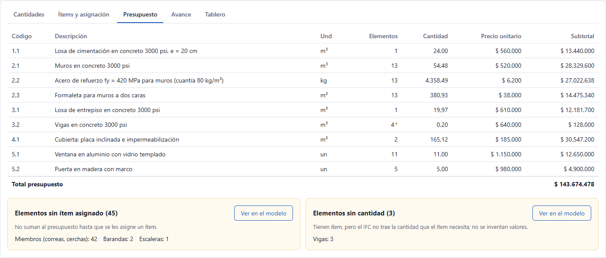
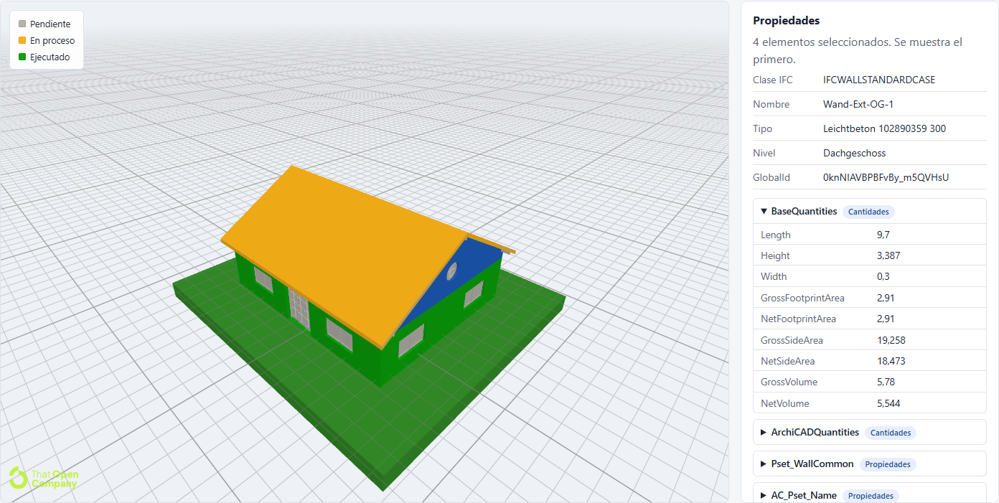
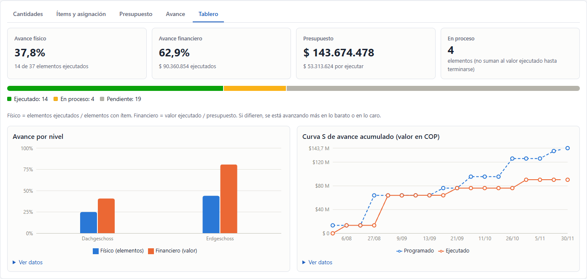
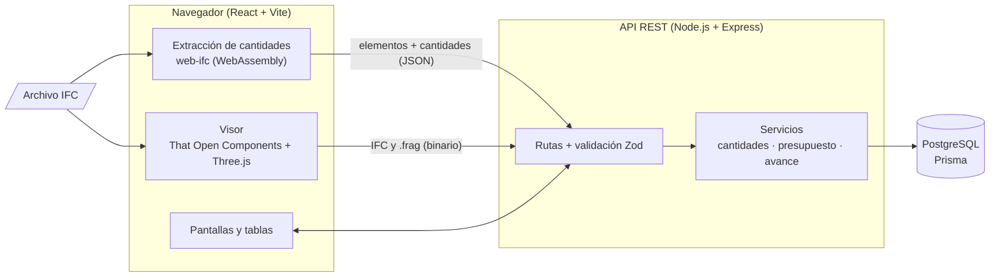
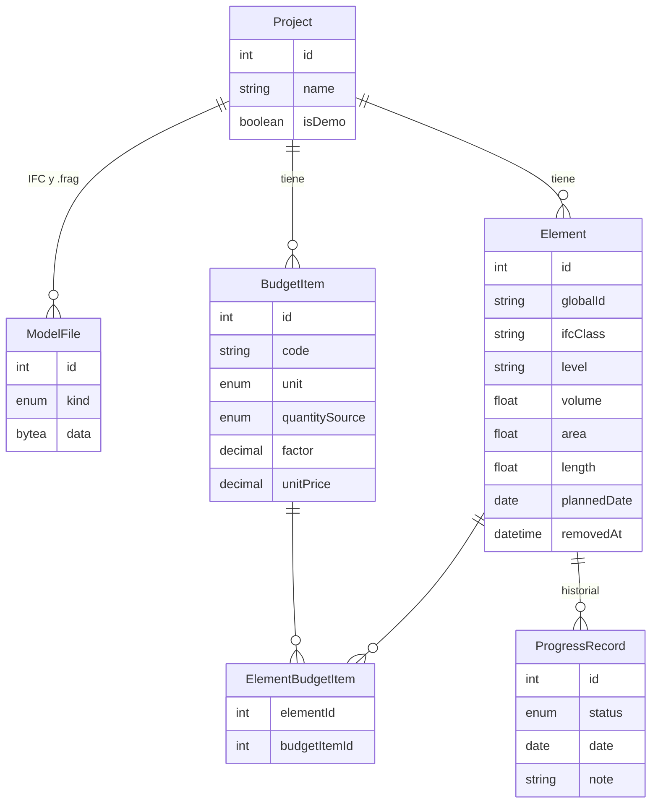

# Control de obra sobre modelo BIM

En obra, el presupuesto vive en Excel, las cantidades se sacan de planos y el avance se reporta en actas que nadie cruza con el modelo. Esta aplicación junta las tres cosas sobre el **modelo BIM (IFC)**: extrae las cantidades del modelo, las valora con ítems de presupuesto (precio unitario de APU) y registra el avance elemento por elemento, con el modelo 3D coloreado según lo ejecutado y un tablero de avance físico y financiero.

**Demo:** _pendiente de desplegar_ (ver [docs/DEPLOY.md](docs/DEPLOY.md)). Incluye un proyecto de demostración listo para explorar.



## Qué hace

- **Visor IFC en el navegador:** órbita, zoom, encuadre y clic en un elemento para ver clase, tipo, nivel, GlobalId, property sets y cantidades.
- **Cantidades de obra** agrupadas por clase IFC, tipo y nivel, con subtotales. Clic en una fila → se resaltan esos elementos en el modelo, y viceversa.
- **Presupuesto:** ítems con código, unidad, fuente de la cantidad, factor y precio unitario en COP. Un elemento puede llevar varios ítems (concreto m³ + acero kg + formaleta m²). Los elementos sin ítem o sin cantidad se listan aparte.
- **Avance de obra:** estado (pendiente, en proceso, ejecutado), fecha y nota por elemento, con historial completo y fechas programadas.
- **Tablero:** avance físico y financiero, avance por nivel y curva S programado vs. ejecutado.

## Capturas

| Visor y propiedades                                                                            | Cantidades                                                                          |
| ---------------------------------------------------------------------------------------------- | ----------------------------------------------------------------------------------- |
|  |           |
| **Presupuesto**                                                                                | **Modelo coloreado por avance**                                                     |
|                      |  |



## Arquitectura



1. El usuario sube un IFC. **El navegador lo procesa**: That Open lo convierte al formato Fragments para el visor y web-ifc extrae elementos y cantidades.
2. El navegador envía la lista de elementos (`POST /elements/bulk`) y guarda el IFC y el `.frag` en el servidor.
3. Presupuesto, avance y tablero trabajan contra PostgreSQL. El **GlobalId** une cada registro con su elemento del modelo 3D.

## Modelo de datos



## Decisiones técnicas

- **GlobalId como vínculo.** Es el identificador estable que el IFC asigna a cada elemento y se conserva entre versiones del modelo. Al reimportar se hace upsert por GlobalId: no se duplican elementos, se conservan sus ítems y su historial, y los que desaparecen se marcan como eliminados en vez de borrarse.
- **El IFC se procesa en el navegador.** web-ifc corre como WebAssembly en el cliente, así que el servidor (capa gratuita, poca CPU y memoria) solo recibe JSON y binarios. El mismo código de extracción ([`shared/src/extraction`](shared/src/extraction)) se ejecuta en Node para los tests y el seed.
- **Los modelos se guardan en PostgreSQL (`bytea`).** El disco de los hostings gratuitos es efímero. El visor recarga el `.frag` (más rápido que reprocesar el IFC) y la descarga usa ETag: si el modelo no cambió, la respuesta es `304` sin leer los bytes.
- **Cantidades sin inventar.** Se buscan en los `IfcElementQuantity` por nombre de cantidad, priorizando los conjuntos estándar (`Qto_*` en IFC4, `BaseQuantities` en IFC2x3) y los valores netos sobre los brutos. Las unidades se convierten a SI desde `IfcUnitAssignment` (un modelo en milímetros no termina con volúmenes en mm³). Si el IFC no trae la cantidad, queda `null` y se muestra como "sin cantidad".
- **Sin doble conteo.** Solo se toman elementos físicos con geometría propia: lo que se ve y se selecciona en el visor. Así no se suman a la vez un muro cortina y sus paneles, ni se cuentan aberturas o espacios.
- **Presupuesto.** Cantidad del ítem = Σ (cantidad base del elemento × factor), redondeada a dos decimales y multiplicada por el precio unitario con `Decimal` (el dinero nunca se calcula con `float`). El factor cubre casos reales: acero = volumen × 80 kg/m³, formaleta = área × 2 caras.
- **Cómo se calculan los avances.**
  - **Físico** = elementos ejecutados / elementos con ítem asignado.
  - **Financiero** = valor ejecutado / presupuesto total. Solo cuenta lo `Ejecutado`, como en un acta de obra; "en proceso" no suma valor.
  - El estado actual de un elemento es su último registro por fecha (y por hora de registro si hay varios el mismo día).
  - La **curva S** recalcula, para cada fecha, el estado que tenía cada elemento ese día, con la misma aritmética del presupuesto. Por eso su último punto coincide con el tablero y con la tabla de presupuesto.
- **Contrato compartido.** Los esquemas Zod de [`shared/`](shared/src) validan las peticiones en el servidor y las respuestas en el cliente, y los mensajes de error salen en español.
- **Pocas dependencias.** Router de dos pantallas sobre la History API, CORS propio de pocas líneas y subida de archivos como cuerpo binario: sin `react-router`, `cors` ni `multer`.

## Cómo correrlo en local

Requisitos: Node.js 24+ y Docker.

```bash
docker compose up -d              # PostgreSQL
npm install && npm run setup      # dependencias, .env, migraciones y proyecto demo
npm run dev                       # API en :3000 y frontend en http://localhost:5173
```

| Comando                              | Qué hace                                                   |
| ------------------------------------ | ---------------------------------------------------------- |
| `npm test`                           | Tests de `shared`, `server` y `client` (Vitest, Supertest) |
| `npm run lint` / `npm run typecheck` | ESLint y TypeScript en todo el monorepo                    |
| `npm run build`                      | Compila los tres paquetes                                  |
| `npm run db:seed -w @bim/server`     | Restablece el proyecto demo                                |

**Tests (87):** extracción contra dos IFC reales, cuyos valores se verificaron leyendo directamente el texto STEP; conversión de unidades; agrupación de cantidades; cálculo del presupuesto y del avance (funciones puras); y la API contra una base de datos de pruebas. El CI de GitHub Actions corre formato, lint, tipos, tests y build en cada push.

## Estructura

```
client/   React + Vite: páginas, tablas, tablero y visor (src/viewer)
server/   API Express: rutas, servicios (lógica de negocio), Prisma y seed
shared/   Esquemas Zod (contrato de la API) y extracción de IFC con web-ifc
samples/  Modelo IFC de ejemplo
docs/     Despliegue e imágenes
```

## Limitaciones conocidas y próximos pasos

- Las cantidades dependen de que el IFC las traiga (opción "Exportar cantidades base" en Revit o ArchiCAD). Calcularlas desde la geometría cuando faltan es el siguiente paso natural.
- Un modelo por proyecto; no hay federación de disciplinas (arquitectura + estructura).
- El avance se registra por elemento completo. No hay avance parcial (por ejemplo, 50 % de una losa).
- Sin autenticación ni roles (residente / director de obra). El proyecto demo está protegido contra borrado y reemplazo del modelo, pero sus ítems y avances se pueden editar; `npm run db:seed` lo restablece.
- El plan gratuito del hosting apaga la API tras unos minutos sin uso: la primera visita tarda hasta un minuto y la interfaz lo avisa.
- Próximos pasos: desglose del APU por insumos, exportar presupuesto y cantidades a Excel/CSV, y avance parcial.

## Créditos

- **Modelo de ejemplo:** _AC20-FZK-Haus.ifc_, Institute for Automation and Applied Informatics (IAI) / Karlsruhe Institute of Technology (KIT), de uso libre ([fuente](https://www.ifcwiki.org/index.php?title=KIT_IFC_Examples)).
- **Fixture de tests:** _Building-Architecture.ifc_, © buildingSMART International Ltd., [CC BY 4.0](https://creativecommons.org/licenses/by/4.0/) ([fuente](https://github.com/buildingSMART/Sample-Test-Files)).
- Visor construido con [That Open Components](https://github.com/ThatOpen/engine_components) y [web-ifc](https://github.com/ThatOpen/engine_web-ifc).
