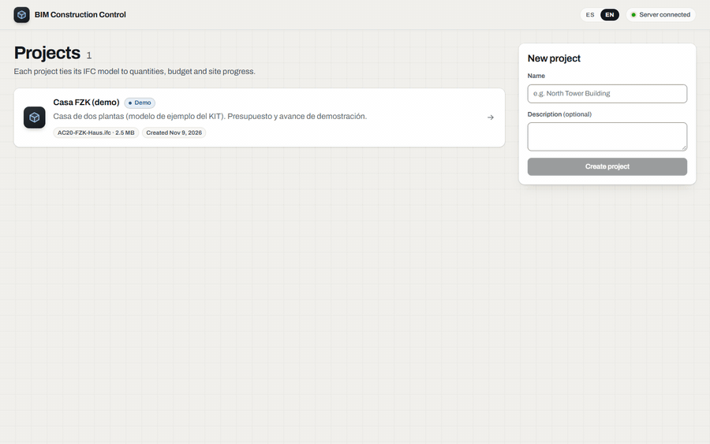
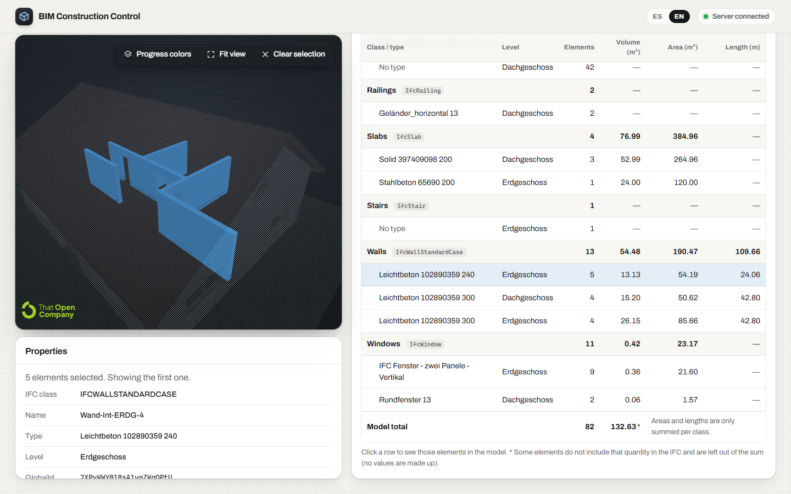
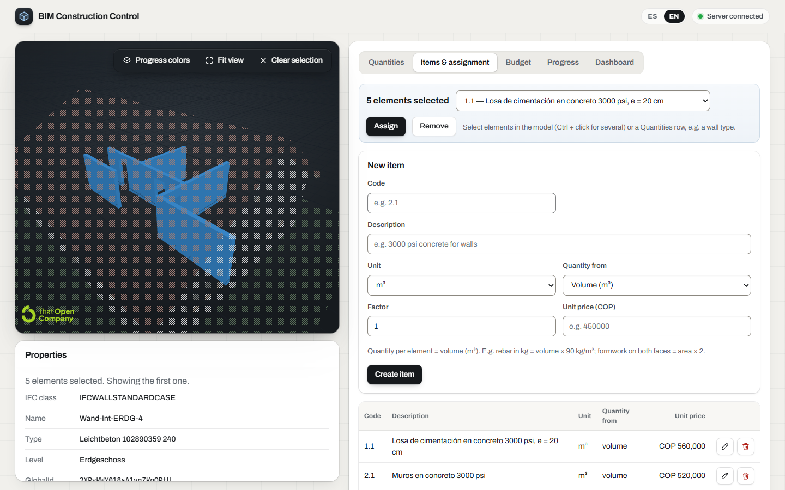
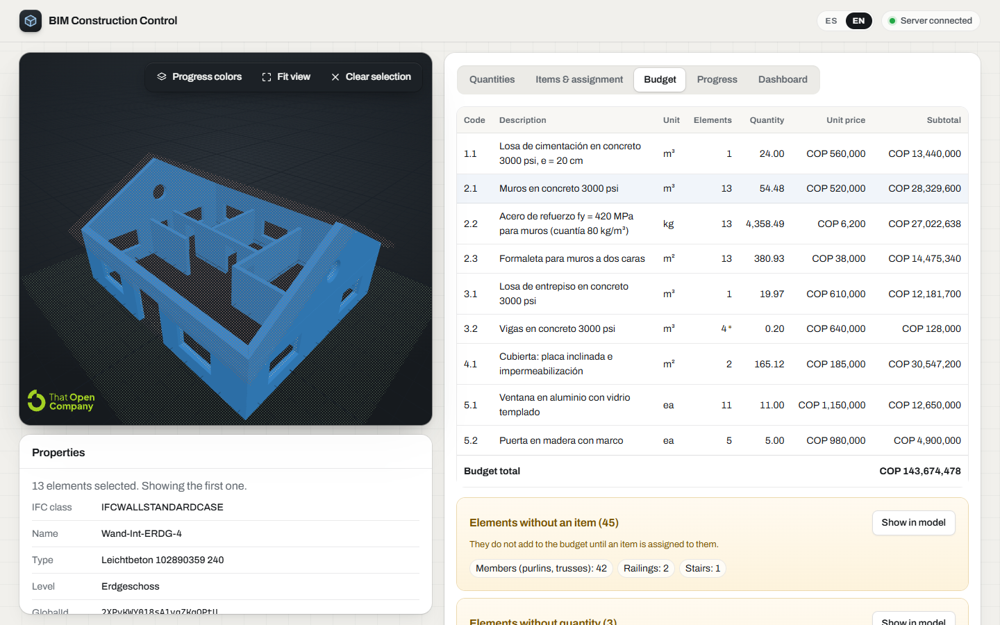
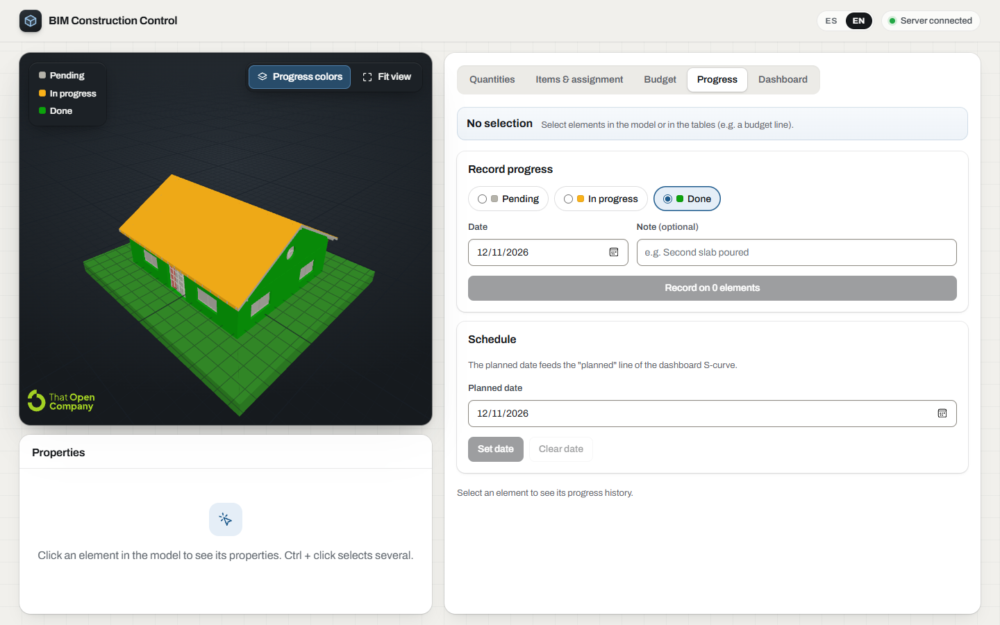
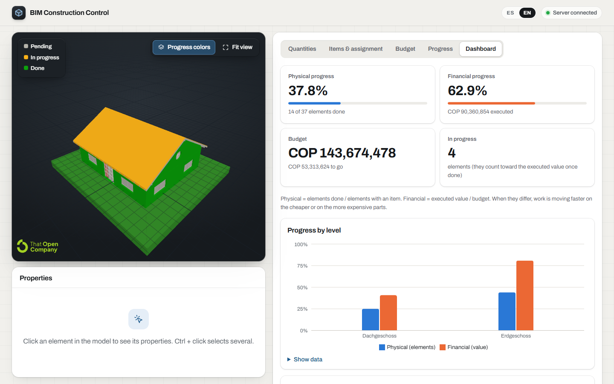
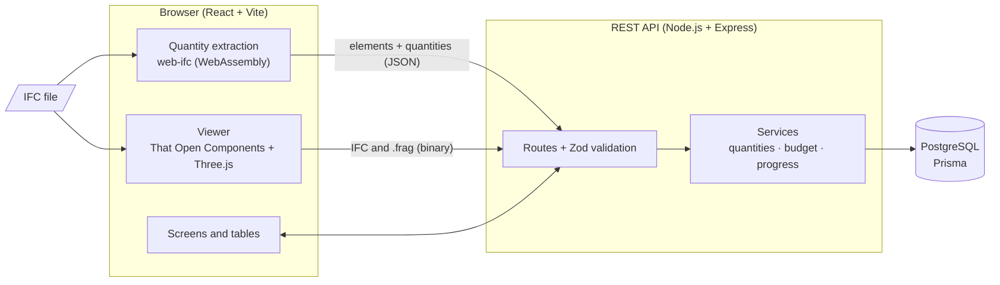
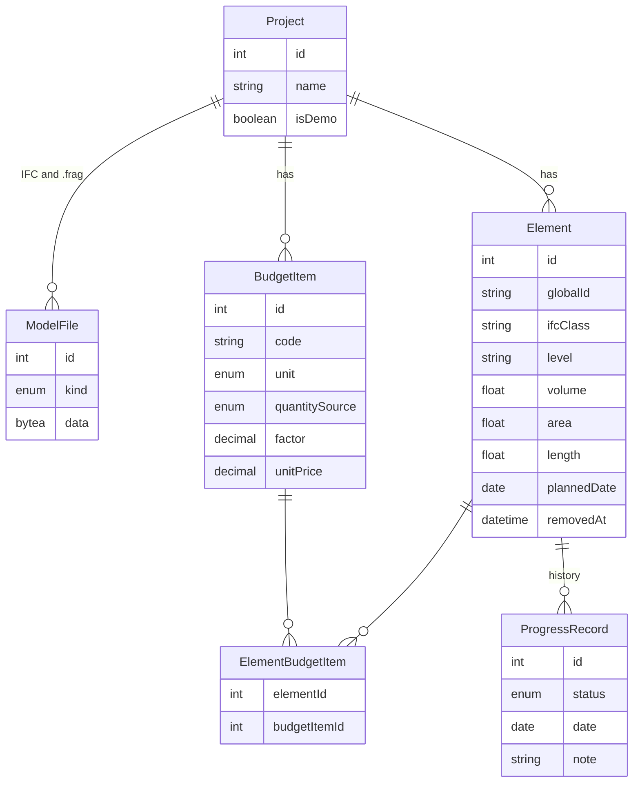

# BIM Construction Control

On a construction site the budget lives in Excel, quantities are taken off drawings and progress is reported in sheets that nobody checks against the model. This application brings the three together on the **BIM model (IFC)**: it takes quantities off the model, prices them with budget items (unit prices from a unit price analysis, in Colombian pesos) and tracks progress element by element, with the 3D model colored by what has been built and a dashboard of physical and financial progress.

**Live demo:** [control-de-obra-sobre-modelo-bim.vercel.app](https://control-de-obra-sobre-modelo-bim.vercel.app). It includes a demo project ready to explore, and you can create projects with your own models or with the [sample IFC models](#sample-ifc-models). The interface is available in Spanish and English (**ES | EN** switch in the top bar). The API runs on Render's free plan: after a while without visits, the first load takes about a minute. To deploy your own copy, see [docs/DEPLOY.md](docs/DEPLOY.md).



## Features

- **IFC viewer in the browser:** orbit, zoom, fit view, and click an element to see its class, type, level, GlobalId, property sets and quantities.
- **Workbench layout:** on wide screens the viewer stays pinned next to the tables, so every click on a row shows its result in the model without scrolling.
- **Quantity takeoff** grouped by IFC class, type and level, with subtotals. Click a row and the model frames those elements and x-rays the rest, so they show even when hidden (beams under the roof, floor slabs); click the model and its properties appear.
- **Budget:** items with code, unit, quantity source, factor and unit price in COP. One element can carry several items (concrete m³ + rebar kg + formwork m²). Elements without an item or without a quantity are listed separately.
- **Site progress:** status (pending, in progress, done), date and note per element, with full history and planned dates.
- **Dashboard:** physical and financial progress, progress by level, and an S-curve of planned vs. executed value.

## Sample IFC models

In the demo, create a new project and use **Upload IFC** (up to 25 MB). These open-license models are good for testing; they are also in [`samples/`](samples/).

| Model                                                                                                            | What it is                                                                                        | Size    |
| ---------------------------------------------------------------------------------------------------------------- | ------------------------------------------------------------------------------------------------- | ------- |
| [AC20-Institute-Var-2.ifc](https://control-de-obra-sobre-modelo-bim.vercel.app/samples/AC20-Institute-Var-2.ifc) | Five-storey office building: 121 walls, 206 windows, 77 doors and 26 slabs, with base quantities. | 10.4 MB |
| [Building-Structural.ifc](https://control-de-obra-sobre-modelo-bim.vercel.app/samples/Building-Structural.ifc)   | Small IFC4 structure: beams, walls and a footing. Loads in seconds.                               | 181 KB  |
| [AC20-FZK-Haus.ifc](https://control-de-obra-sobre-modelo-bim.vercel.app/samples/AC20-FZK-Haus.ifc)               | The demo project's house, to walk through the whole workflow from scratch.                        | 2.5 MB  |

## Screenshots

| Viewer, properties and quantities                                                                                                                  | Items and assignment                                                                                     |
| -------------------------------------------------------------------------------------------------------------------------------------------------- | -------------------------------------------------------------------------------------------------------- |
|  |             |
| **Budget**                                                                                                                                         | **Model colored by progress**                                                                            |
|                                                             |  |



## Architecture



1. The user uploads an IFC. **The browser processes it**: That Open converts it to the Fragments format for the viewer, and web-ifc extracts the elements and their quantities.
2. The browser sends the element list (`POST /elements/bulk`) and stores the IFC and the `.frag` on the server.
3. Budget, progress and dashboard work against PostgreSQL. The **GlobalId** links every record to its element in the 3D model.

## Data model



## Design decisions

- **GlobalId as the link.** It is the stable identifier the IFC gives every element, kept across model versions. Re-importing upserts by GlobalId: elements are not duplicated, their items and history are kept, and elements that disappear are marked as removed instead of deleted.
- **The IFC is processed in the browser.** web-ifc runs as WebAssembly on the client, so the server (free tier, little CPU and memory) only receives JSON and binaries. The same extraction code ([`shared/src/extraction`](shared/src/extraction)) runs in Node for the tests and the seed.
- **Models are stored in PostgreSQL (`bytea`).** Free hosting disks are ephemeral. The viewer reloads the `.frag` (faster than reprocessing the IFC) and the download uses an ETag: if the model has not changed, the answer is a `304` without reading the bytes.
- **No made-up quantities.** They are read from `IfcElementQuantity` by quantity name, preferring the standard sets (`Qto_*` in IFC4, `BaseQuantities` in IFC2x3) and net over gross values. Units are converted to SI from `IfcUnitAssignment` (a model in millimetres does not end up with volumes in mm³). If the IFC lacks a quantity, it stays `null` and is shown as "no quantity".
- **No double counting.** Only physical elements with their own geometry are taken: what you see and select in the viewer. A curtain wall and its panels are not summed together, and openings or spaces are not counted.
- **Budget.** Item quantity = Σ (element base quantity × factor), rounded to two decimals and multiplied by the unit price with `Decimal` (money is never computed with `float`). The factor covers real cases: rebar = volume × 80 kg/m³, formwork = area × 2 faces.
- **How progress is measured.**
  - **Physical** = elements done / elements with an assigned item.
  - **Financial** = executed value / total budget. Only `Done` counts, as in a progress payment certificate; "in progress" adds no value.
  - The current status of an element is its latest record by date (and by recording time when there are several on the same day).
  - The **S-curve** recomputes, for every date, the status each element had that day, with the same arithmetic as the budget. That is why its last point matches the dashboard and the budget table.
- **Two languages without a library.** Spanish and English dictionaries share the same keys (TypeScript and a test check it) and are read through a small store with `useSyncExternalStore`. Numbers and dates follow the language (es-CO or en-US); money stays in Colombian pesos. API errors carry a code that the client translates.
- **Shared contract.** The Zod schemas in [`shared/`](shared/src) validate requests on the server and responses on the client.
- **Few dependencies.** A two-screen router on the History API, a few-line CORS middleware and file uploads as a binary body: no `react-router`, `cors`, `multer` or i18n library.

## Running it locally

Requirements: Node.js 24+ and Docker.

```bash
docker compose up -d              # PostgreSQL
npm install && npm run setup      # dependencies, .env, migrations and demo project
npm run dev                       # API on :3000 and frontend on http://localhost:5173
```

| Command                              | What it does                                                  |
| ------------------------------------ | ------------------------------------------------------------- |
| `npm test`                           | Tests for `shared`, `server` and `client` (Vitest, Supertest) |
| `npm run lint` / `npm run typecheck` | ESLint and TypeScript across the monorepo                     |
| `npm run build`                      | Builds the three packages                                     |
| `npm run db:seed -w @bim/server`     | Resets the demo project                                       |

**Tests (95):** extraction against two real IFC files, whose values were checked by reading the STEP text directly; unit conversion; quantity grouping; budget and progress calculations (pure functions); the API against a test database; and the translation dictionaries. GitHub Actions runs formatting, lint, types, tests and build on every push to `main` and on every pull request.

## Project structure

```
client/   React + Vite: pages, tables, dashboard, viewer (src/viewer) and translations (src/i18n)
server/   Express API: routes, services (business logic), Prisma and seed
shared/   Zod schemas (the API contract) and IFC extraction with web-ifc
samples/  Sample IFC models
docs/     Deployment guide and images
```

## Known limitations and next steps

- Quantities depend on the IFC including them ("Export base quantities" in Revit or ArchiCAD). Computing them from geometry when they are missing is the natural next step.
- One model per project; no federation of disciplines (architecture + structure).
- Progress is recorded per whole element. There is no partial progress (e.g. 50% of a slab).
- No authentication or roles (site engineer / project manager). The demo project is protected against deletion and model replacement, but its items and progress can be edited; `npm run db:seed -w @bim/server` resets it.
- The demo data (project name, budget items) is in Spanish, as a Colombian project would be.
- The free hosting plan stops the API after some minutes without use: the first visit takes up to a minute and the interface says so.
- Next steps: breakdown of unit prices by inputs, exporting budget and quantities to Excel/CSV, and partial progress.

## Credits

- **Sample models:** _AC20-FZK-Haus.ifc_ and _AC20-Institute-Var-2.ifc_, Institute for Automation and Applied Informatics (IAI) / Karlsruhe Institute of Technology (KIT), for unrestricted use ([source](https://www.ifcwiki.org/index.php?title=KIT_IFC_Examples)).
- **Sample model and test fixture:** _Building-Structural.ifc_ and _Building-Architecture.ifc_, © buildingSMART International Ltd., [CC BY 4.0](https://creativecommons.org/licenses/by/4.0/) ([source](https://github.com/buildingSMART/Sample-Test-Files)).
- Viewer built with [That Open Components](https://github.com/ThatOpen/engine_components) and [web-ifc](https://github.com/ThatOpen/engine_web-ifc).
